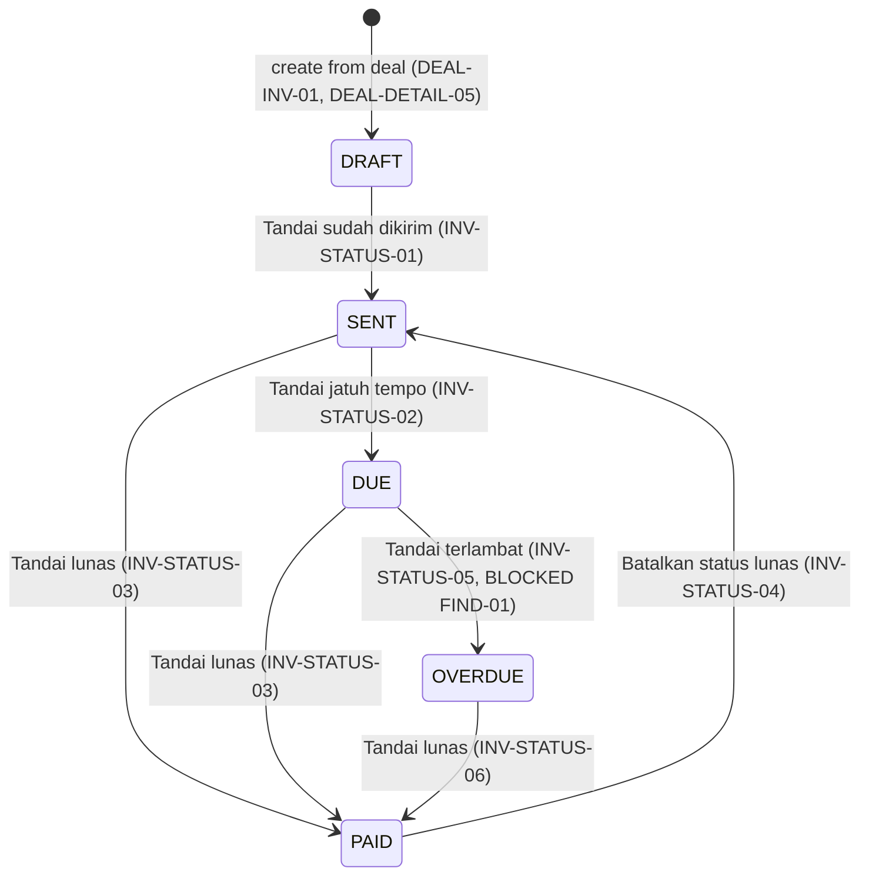
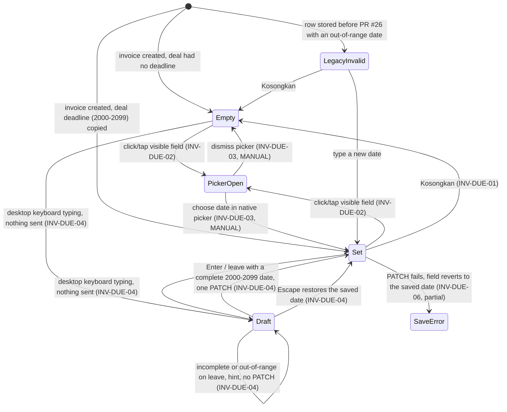
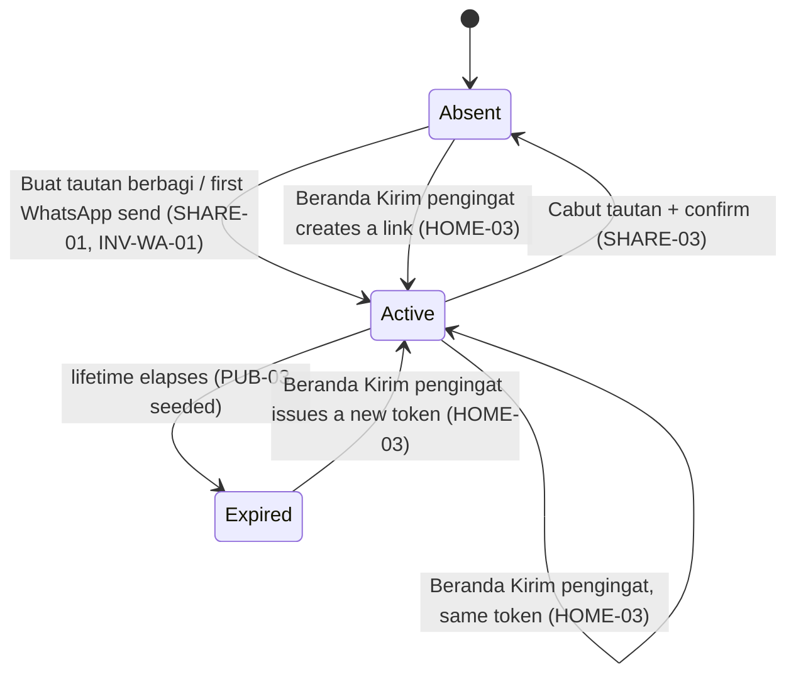

# Journey and state graphs

State models for Dibayar's critical workflows, derived from the implemented
code (not from plans). Every edge names the inventory action that covers
it (`docs/testing/journey-coverage.json`) and its current status. Edges marked
**UNTESTED**, **BLOCKED** or **MANUAL** are open gaps. `npm run coverage:journeys`
fails if an action ID here does not exist in the inventory.

Sources: `src/lib/invoices.ts` (`ALLOWED_STATUS_TRANSITIONS`),
`src/app/(app)/invoice/[id]/invoice-detail-client.tsx` (`NEXT_ACTIONS`),
`src/lib/invoice-date-status.ts` (`deriveInvoiceDisplayStatus`),
`src/lib/invoice-share.ts`, `src/lib/deals.ts`, `prisma/schema.prisma`.

## 1. Invoice payment status

Stored status changes only through the buttons the UI offers. The server
also allows `SENT → OVERDUE`, but no UI control offers it, so it is not a user action.

| Edge | Control | Action | Status |
|---|---|---|---|
| create → DRAFT | Buat invoice (card menu / deal detail) | DEAL-INV-01, DEAL-DETAIL-05 | real (both) |
| DRAFT → SENT | Tandai sudah dikirim | INV-STATUS-01 | real + reload |
| SENT → DUE | Tandai jatuh tempo | INV-STATUS-02 | real + reload |
| SENT → PAID | Tandai lunas | INV-STATUS-03 | partial (no reload, old test) |
| DUE → PAID | Tandai lunas | INV-STATUS-03 | real + reload |
| DUE → OVERDUE | Tandai terlambat | INV-STATUS-05 | **BLOCKED** (FIND-01 product decision) |
| OVERDUE → PAID | Tandai lunas | INV-STATUS-06 | real + reload, list and Beranda agree (`overdue-invoice.spec.ts`, follow-up overlay invoice stored OVERDUE) |
| PAID → SENT | Batalkan status lunas | INV-STATUS-04 | real + reload |
| any → failure | PATCH error | INV-STATUS-07 | **UNTESTED** |
| SENT → OVERDUE | none (server-only) | — | not a user action |

**Displayed vs stored status.** The chip shows `deriveInvoiceDisplayStatus`:
`DRAFT`/`PAID` as stored. For anything else it shows `OVERDUE` when the
Jakarta due date is past, and a stored `OVERDUE` falls back to `SENT` when it
is not. The action buttons follow the *stored* status. So after `DUE → OVERDUE`
with no past due date, the person sees chip **Terkirim** with only
**Tandai lunas** offered (FIND-01). Date-derived display is a pure function
with unit tests (`src/lib/invoice-date-status.test.ts`), and its rendering is
checked by `tests/ux-audit/states/needs-chasing.spec.ts`. In the browser,
`e2e/home/follow-up-queue.spec.ts` (HOME-02) checks the derived reasons on
the Jakarta-date boundaries (due yesterday, today, in 7 and in 8 days) on the
follow-up overlay, and that a stored-SENT invoice due yesterday opens as
**Terlambat** with **Kirim pengingat**. The invoice *list* does not derive:
it groups and labels by stored status, so that same invoice sits under
**Terkirim** there (FIND-06, open, no test asserts it either way).

## 2. Invoice due date

| Edge | Action | Status |
|---|---|---|
| Set → Empty → reload | INV-DUE-01 | real, desktop + mobile |
| Empty/Set → picker opens (click/tap on visible text) | INV-DUE-02 | real, Chromium desktop + 390px mobile emulation (`due-date-integrity.spec.ts`); Firefox/WebKit pass but are feature-detected, so not claimed; real phones **MANUAL** MAN-DUE-01 |
| picker → date chosen → saved → reload | INV-DUE-03 | **MANUAL** MAN-DUE-01; server persistence partial via `fill()` (desktop only) |
| Empty → keyboard typed → Enter → reload → cleared | INV-DUE-04 | real, desktop Chromium: zero PATCHes while typing (through `0002-01-15`), one on Enter, out-of-range refused, Escape restores |
| save failure → revert + retry | INV-DUE-06 | partial: component test plus browser journeys whose failure is injected with `page.route` |
| legacy out-of-range row → page usable, correctable | (FIND-03 regression) | real, `due-date-integrity.spec.ts`; not a separate inventory action |
| consistent display across header/list/queue/WhatsApp | INV-DUE-05 | partial (unit) |

FIND-02 and FIND-03 were fixed by PR #26 (merge `b51fba1`, staging only).

Today versus yesterday (Jakarta) is automated for the follow-up queue
(HOME-02, the overlay computes its dates from the Jakarta calendar day and the
test fails loudly if a run straddles Jakarta midnight). Still open: a year
boundary. The English "Due date" label and
"Not set" empty state after **Clear** and a reload are automated as part of
SET-06 (`e2e/settings/language.spec.ts`, Batch 1); choosing a date in the
native picker stays MAN-DUE-01.

## 3. Share link (owner) and recipient view

Beranda's **Kirim pengingat** calls `POST /share/ensure` (`ensureShare`): it
sends the invoice's existing link when that link is usable -- unexpired, and
its path recoverable -- and writes nothing, so the expiry is not extended. It
issues a new link only when there is none, it has expired, or its path cannot
be recovered. Only **Buat ulang tautan** (`POST /share`,
`createOrRegenerateShare`) rotates a usable link. This fixed FIND-05
(reminders used to rotate, so a link the brand already had returned 404);
`e2e/invoices/reminder-share-link.spec.ts` drives every edge above plus
SHARE-02 with a session-less recipient.

An invoice has one share row, so replacing an expired link leaves the old
token unknown: the old URL then shows the generic not-found page, not the
expired page.

Not covered by this fix: invoice detail's own WhatsApp action reuses whatever
link the page loaded, including an expired one (FIND-07, open).

| Recipient opens `/i/<token>` when the share is… | Expected | Action | Status |
|---|---|---|---|
| active | invoice, no owner controls | PUB-01 | real |
| active, after the owner edits bank details | the new **Pembayaran ke** values | SET-03 | real (link from the owner's page, session-less context) |
| unknown token | generic not-found | PUB-02 | real |
| expired | honest expired state, no data | PUB-03 | real (seeded expiry) |
| revoked while open | not-found after reload | PUB-04 | real (owner revokes via UI) |
| active, PDF | download with parity | PUB-05, PUB-06 | partial (request API) + MAN-PDF-01 |

## 4. Deal pipeline

Stages: `MASUK → NEGO → DEAL → KONTEN → INVOICE → DIBAYAR`. Only adjacent
moves are offered (card menu, deal detail, desktop drag).

| Move | Control | Action | Status |
|---|---|---|---|
| next stage, card menu | Lanjut ke … | DEAL-STAGE-01 | real + reload |
| next stage, detail page + history | Lanjut ke … | DEAL-STAGE-03 | real + reload |
| previous stage, detail page + history | Kembali ke … | DEAL-STAGE-02 | real + reload |
| previous stage, card menu | Kembali ke … | DEAL-STAGE-02 | real + reload |
| drag between columns (desktop) | drag and drop | DEAL-STAGE-04 | real (ux-audit) |
| keyboard move | Tab, Enter, menu | DEAL-STAGE-05 | real (ux-audit) |
| INVOICE → invoice | Buat invoice | DEAL-INV-01, DEAL-DETAIL-05 | real |

## 5. Permissions

| Persona \ resource | Own deal/invoice | Other owner's deal/invoice | Public `/i/<token>` | Protected route |
|---|---|---|---|---|
| Owner (session) | full (all actions above) | not-found UI / 404 API (INV-OWN-01, real) | view | allowed |
| Second owner | — | denied (INV-OWN-01, real) | view | allowed (own data only) |
| Recipient (no session) | — | — | view only, no owner controls (PUB-01, real) | redirect to sign-in (AUTH-01, real) |
| Expired session | — | — | view | redirect (AUTH-07, **UNTESTED**) |

## 6. Combination policy (no Cartesian products)

- **Per-PR gate**: `chromium` (desktop) and `chromium-mobile` (390px, touch),
  Indonesian, deterministic fixture. Each new journey must state which of
  the two projects it runs in and why the other is skipped.
- **Pairwise, not exhaustive**: language is varied on one journey per
  surface (SET-06, `e2e/settings/language.spec.ts`), not on every journey. Firefox/WebKit come
  from the scheduled `e2e-cross-browser` tier.
- **Targeted multi-condition cases** where the risk is real: money (IDR
  formatting, PPh), dates and time zone (Jakarta calendar date vs UTC,
  INV-DUE-05), authorization (INV-OWN-01), and share lifetimes (PUB-03/PUB-04).
- **No duplicate E2E for pure calculations** that unit tests already prove
  (income summary, due-date derivation, invoice numbering). Keep E2E where
  routing, permissions, persistence or the visible control matter.
